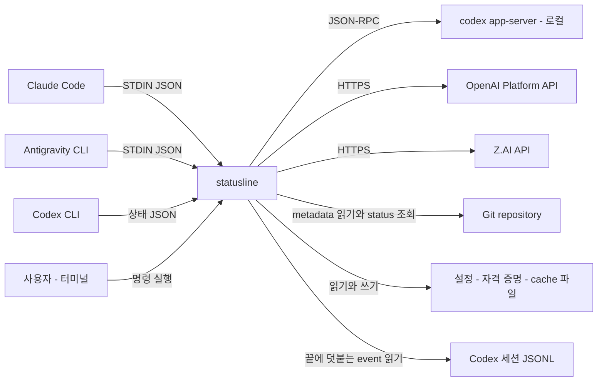
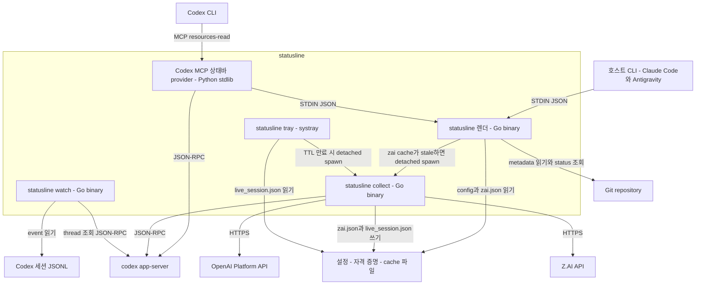
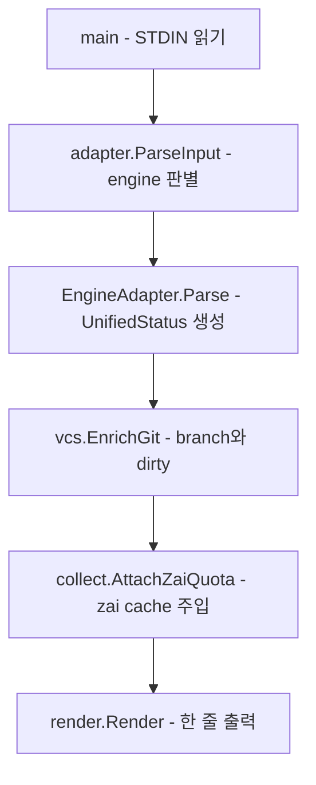
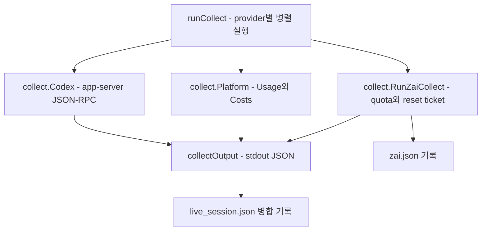
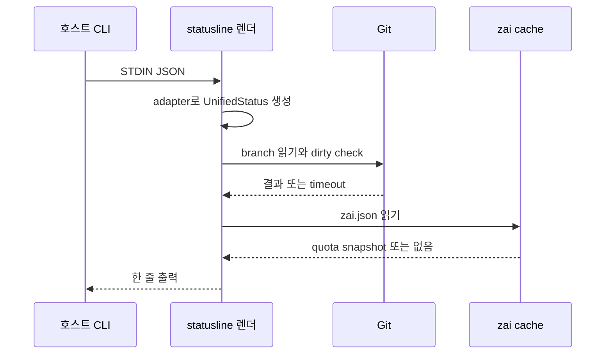
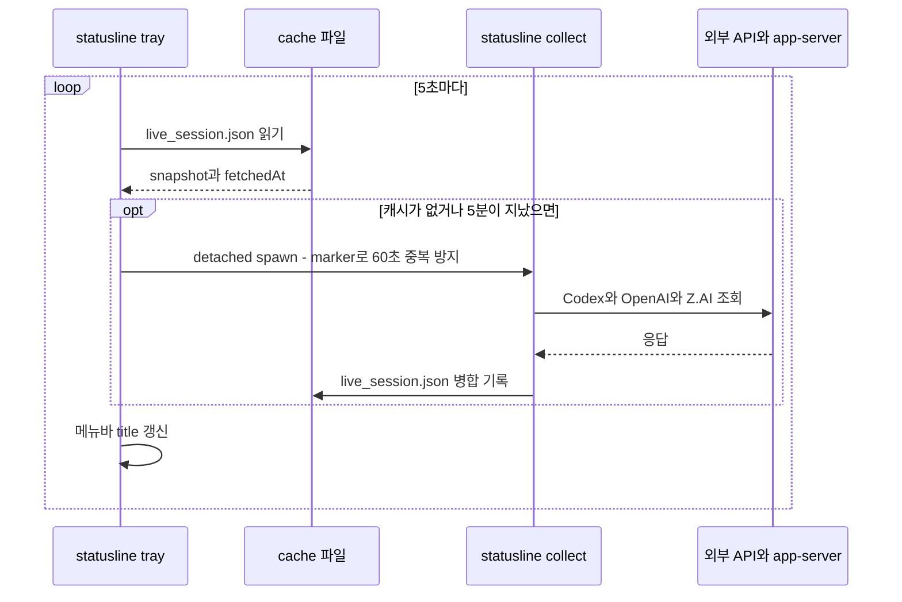

# Explanation: Statusline 아키텍처

`statusline`의 현재 구조를 arc42 12절 순서로 설명한다. 아직 구현되지 않은 계획은 여기에 쓰지 않고 [ROADMAP.md](../../../ROADMAP.md)를 따른다. STDIN payload, 설정, 데이터 출처의 세부 값은 Reference 문서에 있다.

## 목차

- [1. 소개와 목표](#1-소개와-목표)
- [2. 제약 조건](#2-제약-조건)
- [3. 컨텍스트와 범위](#3-컨텍스트와-범위)
- [4. 해결 전략](#4-해결-전략)
- [5. 빌딩 블록 뷰](#5-빌딩-블록-뷰)
- [6. 런타임 뷰](#6-런타임-뷰)
- [7. 배포 뷰](#7-배포-뷰)
- [8. 횡단 개념](#8-횡단-개념)
- [9. 아키텍처 결정](#9-아키텍처-결정)
- [10. 품질 요구](#10-품질-요구)
- [11. 리스크와 기술 부채](#11-리스크와-기술-부채)
- [12. 용어집](#12-용어집)

---

## 1. 소개와 목표

`statusline`은 AI 코딩 어시스턴트 CLI(Claude Code, Antigravity CLI, Codex CLI)의 상태를 받아 한 줄 상태바로 그리고, 구독 잔여량을 수집해 macOS 메뉴바 위젯으로 보여준다.

이해관계자는 셋이다.

- CLI 사용자: host 하단에 모델, context, quota를 확인한다.
- 위젯 사용자: 터미널 밖에서 구독 잔여량을 확인한다.
- 유지보수자: host adapter와 수집 source를 추가한다.

품질 목표는 우선순위가 높은 순이다.

| 우선순위 | 목표 | 확인 방법 |
| :--- | :--- | :--- |
| 1 | 렌더 경로는 어떤 입력 실패에도 한 줄을 출력한다 | `internal/adapter`, `internal/render` test의 빈 입력·깨진 JSON case |
| 2 | 렌더 경로가 host의 화면 갱신을 지연시키지 않는다 | 렌더 예산 5ms, dirty check 10ms deadline |
| 3 | host·provider 추가가 국소적으로 끝난다 | [신규 CLI 어댑터 추가](../how-to-guides/add-new-cli-adapter.md) 절차와 `internal/adapter` test |

## 2. 제약 조건

- **Host 계약**: host CLI는 STDIN으로 JSON을 한 번 넘기고 STDOUT을 상태바에 그린다. 여러 줄을 출력하면 host가 마지막 줄만 남긴다.
- **렌더 경로 분리**: 렌더 경로는 network 호출을 하지 않는다. 수집·감시·위젯은 각각 별도 process로 실행한다.
- **배포 단위**: Go 단일 바이너리. Codex 상태바 provider(`integrations/codex/statusline.py`)만 Python 표준 library로 따로 둔다.
- **읽기 전용 수집**: Codex 인증 파일과 로그인 상태는 직접 읽거나 바꾸지 않는다.
- **비밀 값**: git에 추적하는 비밀 값은 `sops`로 암호화하고, sample의 계정 식별 정보는 generic 값으로 바꾼다.
- **실행 환경**: Go 1.26.5. 위젯은 macOS 메뉴바만 구현했다.

## 3. 컨텍스트와 범위

`statusline`과 상호작용하는 사용자와 외부 system이다. 다이어그램은 C4 L1(System Context)이므로 `statusline` 내부는 그리지 않는다.

| 외부 element | 역할 |
| :--- | :--- |
| Claude Code, Antigravity CLI | 상태가 바뀔 때마다 `statusline`을 실행하고 STDIN으로 session 상태 JSON을 넘긴다 |
| Codex CLI | MCP 상태바 provider를 호출해 하단 상태바를 그린다 |
| codex app-server | `codex app-server --stdio`로 띄우는 로컬 JSON-RPC server. 계정·한도·사용량·thread 정보를 준다 |
| OpenAI Platform API | 조직의 Completions Usage와 Costs. 관리자 key가 있을 때만 조회한다 |
| Z.AI API | 5시간·월간 quota와 reset ticket |
| Git repository | branch·repo 이름과 dirty 상태 |
| 파일 | `config.json`, `credentials.json`, cache 파일 |
| Codex 세션 JSONL | `watch`가 따라가는 로컬 session 기록 |

범위 밖은 host CLI 자체, Codex app-server, OpenAI·Z.AI API, IDE 확장이다. IDE agent 감시와 dashboard는 [ROADMAP.md](../../../ROADMAP.md)의 계획 항목이다.

## 4. 해결 전략

1. **하나의 중간 모델**: `internal/adapter`가 host마다 다른 payload를 `model.UnifiedStatus` 하나로 정규화한다. `internal/render`는 이 구조체만 그리므로 host가 늘어도 renderer는 바뀌지 않는다.
2. **렌더와 수집 분리**: 렌더는 STDIN에서 STDOUT으로 한 번에 끝난다. 수집은 `collect`, 감시는 `watch`, 위젯은 `tray`가 별도 process로 맡한다. 두 경로는 network 호출 없이 파일 cache로 값을 주고받는다.
3. **조용한 실패**: 입력이 비거나 깨져도, 외부 조회가 실패해도 오류를 내지 않고 표시할 수 있는 segment만 그린다.
4. **host 추가 절차**: adapter 구현, `ParseInput`의 판별 분기와 dispatch 분기 추가, sample fixture, test. 절차는 [신규 CLI 어댑터 추가](../how-to-guides/add-new-cli-adapter.md)에 있다.

## 5. 빌딩 블록 뷰

### 5.1 Container (C4 L2)

같은 Go binary를 argument에 따라 네 가지 container로 실행한다. Codex용 MCP provider는 별도 script다. `statusline init`은 기본 설정 파일을 쓰는 일회성 command라 이 뷰에서는 뺐다.

위젯은 `collect`의 출력을 직접 받지 않고 cache 파일로만 읽는다.

### 5.2 내부 package

| 위치 | 역할 | 의존하는 내부 package |
| :--- | :--- | :--- |
| `cmd/statusline` | entry point. option·subcommand 분기, STDIN 읽기, exit code | adapter, collect, config, render, tray, vcs |
| `internal/adapter` | host payload를 `UnifiedStatus`로 정규화한다. `auto` 판별과 Z.AI provider 감지 | model |
| `internal/model` | `UnifiedStatus`와 공유 type | 없음 |
| `internal/render` | `UnifiedStatus`와 config로 한 줄 ANSI 문자열을 만든다 | config, model |
| `internal/config` | 설정 읽기, 기본값, 저장, `$schema` migration | 없음 |
| `internal/vcs` | `.git` metadata로 branch·repo를 읽고 10ms deadline으로 dirty를 확인한다 | model |
| `internal/collect` | Codex·OpenAI Platform·Z.AI 수집, 자격 증명, cache 파일, self-spawn, `watch` | model |
| `internal/tray` | 위젯 title·menu 문자열과 갱신 조건 판정 | collect |
| `integrations/codex/statusline.py` | Codex가 호출하는 stdio MCP provider. Codex 상태를 렌더러 payload로 바꾼다 | 저장소 루트의 `./statusline` |

### 5.3 렌더 container 내부 (C4 L3)

`--cli`가 `auto`이면 `ParseInput`이 STDIN JSON의 marker와 환경변수로 engine을 정한다. `AttachZaiQuota`는 Z.AI provider일 때만 동작하고, cache가 없거나 5분이 지났고 token이 있으면 `collect --provider=zai`를 detached로 실행한다. 결과는 기다리지 않는다.

### 5.4 collect container 내부 (C4 L3)

## 6. 런타임 뷰

### 6.1 상태바 한 번 그리기

host가 상태를 갱신할 때마다 실행되는 기본 경로다.

Z.AI provider에서 cache가 없거나 5분이 지났으면 `statusline`은 끝나기 직전에 `collect --provider=zai`를 detached process로 띄운다. 결과는 기다리지 않고, `zai.json.refresh` marker가 60초 동안 같은 실행을 막는다.

### 6.2 위젯 갱신

`collect`는 provider를 병렬로 조회하고 10초 안에 끝난다. 하나가 실패하면 `errors`에 남기고, 성공한 provider의 결과만 cache에 반영한다. 위젯은 다음 poll에서 갱신된 cache를 읽는다.

## 7. 배포 뷰

모든 container는 개발자 한 사람의 컴퓨터(macOS, Linux)에서 실행된다. server는 없다.

| Artifact | 위치 | 비고 |
| :--- | :--- | :--- |
| `statusline` binary | 저장소 build 산출물 또는 `~/.local/bin` | host 설정과 Codex MCP provider가 참조한다 |
| `integrations/codex/statusline.py` | 저장소 | `codex mcp add`로 등록한다. 저장소 루트의 `./statusline`을 호출한다 |
| `config.json` | `~/.config/statusline/` | `statusline init`이 기본값을 기록한다 |
| `credentials.json` | `~/.config/statusline/` | 권한 `0600`이 필요하다 |
| `zai.json`, `live_session.json`과 refresh marker | user cache dir의 `statusline/` | macOS `~/Library/Caches`, Linux `~/.cache` |

| Container | 누가 실행하나 | 생애 주기 |
| :--- | :--- | :--- |
| 렌더 | host CLI 또는 MCP provider | 한 줄을 그리고 종료 |
| MCP provider | Codex 세션 | 세션 동안 stdio로 대기 |
| collect | 사용자, 렌더, tray | 일회성, 최대 10초 |
| watch | 사용자 | `Ctrl+C`까지 |
| tray | 사용자 | 드롭다운에서 종료할 때까지 |

Codex 등록 절차는 [Codex 데이터 수집 사용 가이드](../how-to-guides/use-codex.md#6-codex-mcp-상태바-설정), 위젯 실행은 [트레이 위젯 사용하기](../how-to-guides/use-tray.md)를 따른다.

## 8. 횡단 개념

- **Fail-soft**: 렌더 경로는 입력이 비거나 깨져도, 일부 조회가 실패해도 표시할 수 있는 segment만 그리고 오류를 stdout에 쓰지 않는다. `collect`는 source별 오류를 `errors` object에 모은다.
- **성능 예산**: 렌더 목표는 5ms이다. subprocess는 dirty check(`git status`) 하나뿐이고 10ms deadline이 걸려 있다. branch와 repo 이름은 `.git` metadata를 직접 읽는다.
- **중복 실행 방지**: refresh marker(`zai.json.refresh`, `live_session.json.refresh`)가 60초 동안 같은 갱신을 다시 띄우지 않는다.
- **자격 증명**: 환경변수가 `credentials.json`보다 우선하고, 파일은 권한이 `0600`이어야 한다. `ANTHROPIC_BASE_URL`의 host가 `api.z.ai` 또는 `bigmodel.cn`일 때만 Z.AI provider로 판정한다.
- **수집 범위**: 읽기 전용 조회만 한다. 사용자 message와 turn 본문은 출력하지 않는다.
- **개발 규칙**: Go 기능 추가는 TDD, `gofmt`를 지킨다. Codex 수집은 read-only를 유지한다. 문서는 Diátaxis와 OKF hub를 따른다.
- **의존성**: 표준 library를 우선하고, 외부 의존성은 ANSI 출력의 `lipgloss`와 메뉴바의 `fyne.io/systray`가 대부분이다.

## 9. 아키텍처 결정

ADR record를 위한 `decisions/` directory는 아직 두지 않았다. 결정의 배경은 [설계 결정 사항](./design-decisions.md)에 있다.

| 결정 | 이유 | 근거 |
| :--- | :--- | :--- |
| 상태바는 한 줄만 출력한다 | host가 여러 줄을 버린다 | 설계 결정 사항 1절 |
| 실패는 조용히 축소한다 | 상태바가 오류로 사라지는 것이 일부 정보 누락보다 나쁘다 | 설계 결정 사항 2절 |
| 배경 daemon 없이 파일 cache로 연결한다 | 단일 바이너리를 유지하고 렌더 경로에 network를 넣지 않기 위해 | 설계 결정 사항 2절, 이 문서 4절 |
| `--cli`와 `--provider`를 나눈다 | host CLI와 서비스 계정이 서로 독립적으로 바뀐다 | ROADMAP v0.5.2, [CLI 레퍼런스](../reference/cli.md) |

## 10. 품질 요구

| 품질 | Scenario | 기대 반응 |
| :--- | :--- | :--- |
| 지연 | dirty 상태의 git repository에서 렌더 | 5ms 목표. dirty check가 10ms를 넘으면 branch는 유지하고 dirty 표시만 생략 |
| 견고성 | 빈 입력, 깨진 JSON, 알 수 없는 engine | 한 줄 기본 출력, exit code 0 |
| 부분 실패 | provider 하나가 실패한 `collect` | 나머지 source 결과는 cache에 반영, 실패는 `errors`에 기록 |
| 자원 | 위젯 상주 | 상주 process는 tray 하나, 5초마다 cache 파일만 읽음 |
| 이식성 | macOS, Linux에서 렌더·수집 | 동일하게 동작. 위젯은 macOS만 |

## 11. 리스크와 기술 부채

| 리스크 | 영향 | 대응 |
| :--- | :--- | :--- |
| git repository에서 렌더가 5ms 목표를 넘을 수 있다. 2026-11 macOS 실측은 약 8.5ms였다 | host 화면 갱신이 느려질 수 있다 | ROADMAP v0.9.0의 렌더 성능 하드닝 |
| macOS에서 `/home` 하위 경로의 stat이 느리다. `readGitInfo`가 상위 경로를 순차 조회하므로 해당 cwd에서는 약 38ms가 걸린다 | sample test command가 느려지고 branch segment가 빠진다 | sample의 cwd를 `/home` 밖으로 유지 |
| Z.AI quota와 reset ticket API는 공개 문서가 없는 endpoint다 | 응답이 바뀌면 ticket은 0으로, quota는 `errors.zai`로 조용히 빠진다 | [설정 파일 스키마](../reference/configuration-schema.md)의 점검 명령 |
| Z.AI token이 오래되면 HTTP 200으로 돌아온다 | 오류 없이 quota segment만 사라진다 | `credentials.json`의 token 갱신. 같은 문서의 token rotation note |
| Codex MCP 상태바는 Codex 실험 기능과 저장소 루트의 build 산출물에 의존한다 | Codex 버전이 바뀌거나 binary가 없으면 상태바가 비거나 안내 문구가 보인다 | [CLI 페이로드 명세](../reference/cli-payload-spec.md#3-codex-widget-snapshot), `AGENTS.md`의 smoke test |
| `live_session.json`은 0644로 기록되고 계정 식별 정보를 담을 수 있다 | 여러 사용자가 있는 machine에서 다른 사용자가 읽을 수 있다 | 공유 machine에서는 cache dir 권한 확인 |
| 위젯은 macOS 전용이다 | Windows 사용자는 `collect` 결과를 JSON으로만 본다 | ROADMAP v0.8.5 |
| `anthropic`, `gemini` provider는 미지원이다 | `collect --provider`가 exit 2로 거절한다 | ROADMAP v0.6.0 |

## 12. 용어집

| 용어 | 뜻 |
| :--- | :--- |
| engine | 상태바를 그리는 host의 종류. `--cli` 값(`claude`, `codex`, `antigravity`, `auto`) |
| provider | 구독 계정의 종류. `--provider` 값(`chatgpt`, `zai`, `zhipu`). engine과 독립이다 |
| adapter | host의 payload를 `UnifiedStatus`로 바꾸는 struct. `EngineAdapter` interface를 구현한다 |
| `UnifiedStatus` | 모든 host가 공통으로 쓰는 상태 struct. renderer의 유일한 입력 model이다 |
| segment | 상태바를 이루는 개별 표시. `layout`이 순서를 정한다 |
| fail-soft | 실패해도 오류를 밖으로 드러내지 않고 표시할 수 있는 부분만 출력하는 설계 |
| cache | 렌더·위젯이 읽는 수집 결과 파일. `zai.json`과 `live_session.json` |
| refresh marker | 갱신 실행 직후 남기는 파일. 60초 동안 중복 실행을 막는다 |
| reset ticket | Z.AI가 1회 단위로 주는 quota 초기화권. 개수와 가장 빠른 만료일을 표시한다 |
| cycle mode | Antigravity의 작업 모드(`plan`, `accept-edits`, `auto`). Codex에서는 speed 표시가 같은 자리를 쓴다 |
| MCP 상태바 provider | Codex가 MCP로 호출하는 `statusline.py`. Codex 상태를 렌더러 payload로 바꾼다 |
